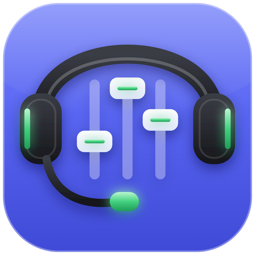

# Discord Volume Mixer für Stream Deck

**Stell die Lautstärke jeder Person in deinem Discord-Sprachchat direkt am Stream Deck ein.**

[English](README.md) · Deutsch

---

## Was das Plugin kann

- 🔊 **Lautstärke pro Person** – Leute im Sprachkanal lauter oder leiser stellen, ideal mit den Drehreglern des **Stream Deck +**
- 🔇 **Jede Person stummschalten** mit einem Tastendruck
- 🟢 **Sehen, wer spricht** – die Taste leuchtet, solange jemand redet
- 🎙️ **Eigenes Mikrofon und Ton aus** auf einer Taste
- 🧩 **Für alle Decks** – Standard, Mini, XL, Mobile und Stream Deck +
- 🌍 **Verfügbar auf** Englisch, Deutsch, Spanisch, Französisch, Italienisch, Portugiesisch, Polnisch, Niederländisch, Japanisch, Koreanisch und Chinesisch

## Installation

1. Lade die neueste `.streamDeckPlugin`-Datei aus den [Releases](../../releases) herunter und doppelklicke sie.
2. Leg die Aktion **Discord Volume Mixer** auf eine Taste.
3. Richte einmalig deine eigene Discord-App ein (dauert zwei Minuten), siehe unten.

> **Du kommst vom Original-Plugin?** Diese Version ersetzt es direkt. Einstellungen, Client-ID/Secret und Layouts bleiben erhalten.

## Discord-App einrichten

Discord erlaubt nur selbst registrierten Apps, deinen Sprachchat zu steuern. Deshalb braucht jede Person ihre eigene (kostenlose) Discord-App:

1. Öffne das [Discord Developer Portal](https://discord.com/developers/applications) mit **demselben Konto, das du in der Discord-App nutzt**, und klicke auf **New Application**.
   - Der Name ist egal, er darf aber **nicht das Wort „Discord“ enthalten** (das lehnt Discord ab).
2. Füge unter **OAuth2** die Weiterleitung `http://localhost:1337/callback` hinzu und klicke auf **Save Changes**.
3. Kopiere die **Client ID** und das **Client Secret** (siehst du nur *Reset Secret*, klick darauf).
4. Füge beides in den Einstellungen der Discord-Volume-Mixer-Taste ein. Die Werte sind verdeckt, mit dem 👁 Auge kannst du sie anzeigen.
5. Drück die Taste und klicke im Discord-Fenster auf **Autorisieren**. Fertig!

Behandle das Client Secret wie ein Passwort und gib es nicht weiter.

## Was die Tasten anzeigen

| Text auf der Taste | Bedeutung | Was tun |
| :--- | :--- | :--- |
| `EINRICHTUNG NÖTIG` | Client-ID oder Secret fehlt | Beides in den Tasteneinstellungen eintragen |
| `DISCORD LÄUFT NICHT` | Die Discord-App ist geschlossen | Discord starten, das Plugin verbindet sich von selbst |
| `DISCORD NOCH NICHT BEREIT` | Discord startet noch | Kurz warten |
| `IN DISCORD FREIGEBEN` | Discord zeigt ein Freigabe-Fenster | In Discord auf **Autorisieren** klicken |
| `ABGELEHNT – DRÜCKEN ZUM WIEDERHOLEN` | Freigabe abgelehnt oder Zeit abgelaufen | Taste drücken und in Discord freigeben |
| `CLIENT-ID PRÜFEN` | Discord akzeptiert die Client-ID nicht | ID prüfen; die App muss zu dem Konto gehören, das du in Discord nutzt |
| `SECRET PRÜFEN` | Discord akzeptiert das Secret nicht | Secret im Developer Portal zurücksetzen und neu eintragen |
| `WARTE AUF INTERNET` | Discord-Server nicht erreichbar (z. B. direkt nach dem Hochfahren) | Nichts, es verbindet sich automatisch |
| `NIEMAND IM KANAL` | Du bist allein oder in keinem Sprachkanal | Einem Sprachkanal beitreten |

Die Tasten **Discord Volume Mixer**, **Mikrofon** und **Ton aus** werden abgedunkelt, solange das Plugin nicht verbunden ist, und zeigen einen kurzen Status: rot `DISCORD AUS`, wenn Discord geschlossen ist, gelb beim Verbinden oder wenn du noch freigeben musst. Sobald du Discord startest, verbindet sich das Plugin innerhalb weniger Sekunden.

Achte außerdem darauf, dass Discord und die Stream-Deck-Software **ohne** Administratorrechte laufen.

### Log senden

Leg eine leere Datei `clog.txt` in `%appdata%\Elgato\StreamDeck\Plugins\cz.danol.discordmixer.sdPlugin\` an, wiederhole das Problem und hänge die Datei an ein [Issue](../../issues) an. Lösch sie danach wieder, sie wächst sonst immer weiter.

## Selbst bauen

Siehe [englische Anleitung](README.md#building-from-source).

## Credits

Erfunden und gebaut hat dieses Plugin **[Danol (Daniel Čejchan)](https://github.com/CZDanol)**. Das [Original-Projekt](https://github.com/CZDanol/StreamDeck-DiscordVolumeMixer2) samt den Bibliotheken [QtStreamDeck2](https://github.com/CZDanol/QtStreamDeck2) und [QtDiscordIPC](https://github.com/CZDanol/QtDiscordIPC) ist seine Arbeit. Seit er die Entwicklung 2024 beendet hat, wird das Plugin hier als Community-Fork weitergeführt. Danke, Danol!

- **Danol** – ursprünglicher Autor
- **[Krabs](https://github.com/krabs-github)** – Profile für das XL und Tests des Original-Plugins
- **Jan** – Maintainer dieses Forks
- Gebaut mit [Qt 6](https://www.qt.io/) (LGPLv3)

Icons und App-Icon wurden für diesen Fork neu gestaltet und sind Teil des Projekts (GPLv3).

## Lizenz

[GNU General Public License v3.0](LICENSE.md), wie das Original-Projekt.

Nicht mit Discord Inc. oder Elgato/Corsair verbunden. Discord ist eine Marke der Discord Inc.
